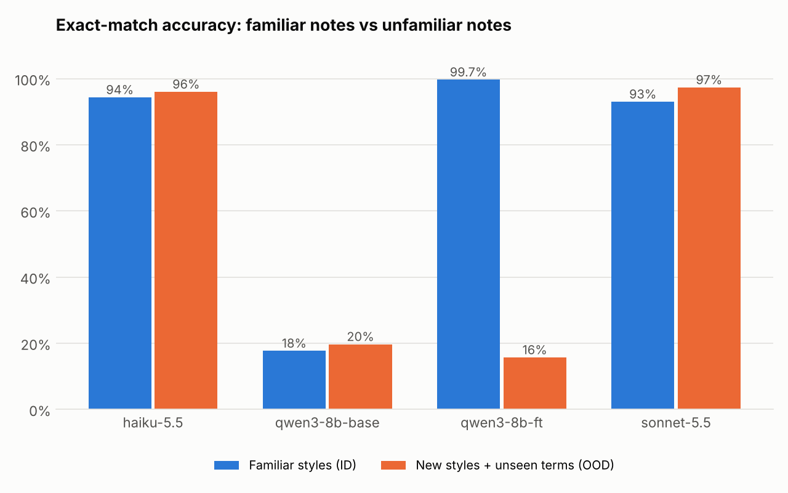
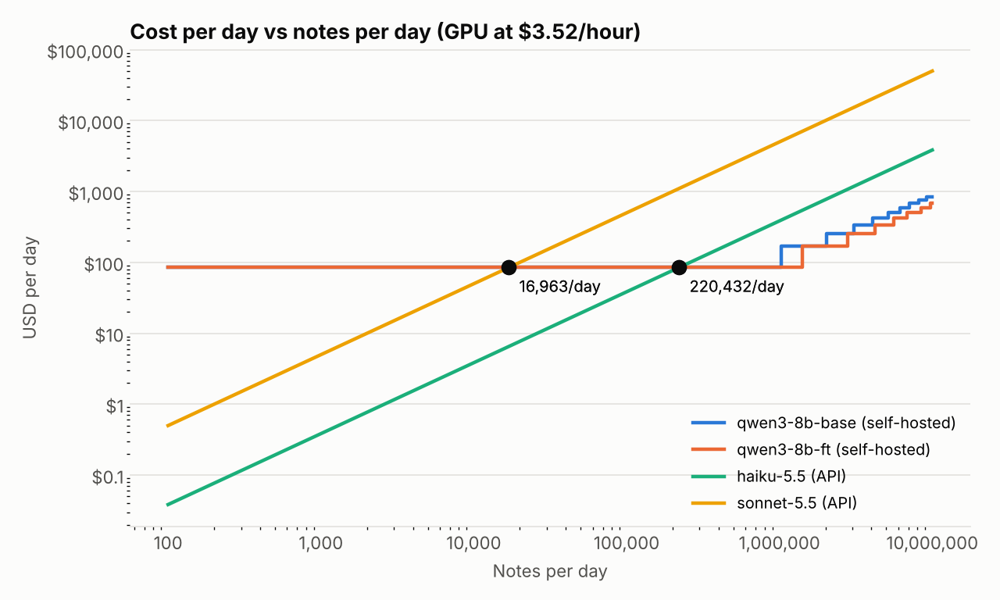

# When does fine-tuning beat the API?

A fine-tuned 8B open model vs frontier APIs on one narrow, realistic task: **pulling structured data out of clinical notes**.

| Model | How it's used |
|---|---|
| Qwen3-8B, untuned | prompted, served on vLLM |
| Qwen3-8B + QLoRA | fine-tuned on 2,000 notes, served on vLLM |
| Claude Haiku 5.5 | prompted, Claude API |
| Claude Sonnet 5.5 | prompted, Claude API |

All four get the **same prompt**. They're compared on accuracy, cost per 1,000 notes, p50/p95 latency, and the
**daily volume at which renting a GPU becomes cheaper than paying per token**.

## Results (Nov 2026, Qwen3-8B QLoRA on one A100)

| Model | Exact match: familiar notes | Exact match: new styles + unseen terms | Cost / 1,000 notes |
|---|---|---|---|
| Qwen3-8B, untuned | 17.7% | 19.7% | $0.08* |
| **Qwen3-8B, fine-tuned** | **99.7%** | **15.7%** | $0.06* |
| Claude Haiku 5.5 | 94.3% | 96.0% | $0.38 |
| Claude Sonnet 5.5 | 93.0% | 97.3% | $4.99 |

\* self-hosted cost assumes the GPU is fully busy (~57,000 notes/hour measured with vLLM). An always-on A100 at
$3.52/hour beats **Sonnet above ~17,000 notes/day** and **Haiku only above ~220,000 notes/day**.

**The fine-tuned model learned the format, not the task.** It was near-perfect on notes like its training data and
fell to 16% on new ones, below the untuned model:
- it copied Celsius temperatures as Fahrenheit in 205 of 240 Celsius notes (training never contained Celsius);
- it got only 36% of never-seen ICD-10 codes right (e.g. carpal tunnel: G56.90 instead of G56.00).

Other findings: Haiku 5.5 bills ~620 output tokens per note for ~200 visible ones (hidden reasoning), and on 3 notes
Haiku/Sonnet looped on one diagnosis until the 1,024-token cap. Full tables: [`results/REPORT.md`](results/REPORT.md).




**A bug I caught in my own labels.** ICD-10-CM requires combination codes when hypertension or diabetes occurs with
kidney disease or neuropathy (e.g. I12.9, E11.22, E11.42), and the Claude models used them. My generator didn't, so
the scorer now accepts a combination code *only when the companion condition is in the note*. This raised Haiku's
familiar-notes score from 89.3% to 94.3%; no other conclusion changed.

## The task
Each note becomes JSON: age, sex, chief complaint, diagnoses with **ICD-10-CM codes**, current medications
(name, dose, frequency), allergies, five vitals, smoking status and follow-up interval.
Every note also contains **traps that must not be extracted**: family history, ruled-out conditions and
discontinued medications.

## Why the test is hard to game
The data is synthetic (no patient data anywhere) but built so a fine-tuned model can't win just by memorising:

- **Two test sets.** `test_id` uses the 3 training note styles (SOAP, narrative, H&P) with new patients.
  `test_ood` uses 2 styles **never seen in training**: telegraphic shorthand (`67yo F c/o ... RTC 2 wks`)
  and dictation with temperatures in Celsius and follow-up in days.
- **Held-out vocabulary.** 8 conditions and 6 drugs appear *only* in `test_ood`. The report shows recall on
  seen vs never-seen codes separately. That's where a small fine-tuned model is most likely to break.
- **Latin abbreviations** (`bid`, `qhs`, `q6h prn`) appear only in `test_ood`.
- **No leakage.** No test note is identical to a training note, and tests check that distractors never enter labels.

## Scoring
13 fields per note. ICD-10-CM combination codes (I12.9, E11.22, E11.42, ...) count as correct when the
companion condition is in the note. Scalars are right or wrong (temperature within ±0.2 °F, because Celsius notes round-trip with
rounding). Diagnoses are matched by ICD-10 code, medications by (name, dose, frequency), allergies by name; list
fields also get precision, recall and F1. **Exact match** means every field is right. Invalid JSON scores zero.

## Cost model
- **API:** measured tokens × list price. Haiku 5.5 is $0.10 / $0.50 and Sonnet 5.5 is $2 / $10 per million input /
  output tokens (Nov 2026). `--batch` applies the Batch API's 50% discount.
- **Self-hosted:** an always-on GPU at your hourly rate. Throughput is **measured** with vLLM under 64 concurrent
  requests. Training cost is amortised over 30 days.
- **Break-even** = the first daily volume where the GPU costs less per day than the API.
  Pass your real GPU price with `--gpu-hourly`: the answer depends on it.

## Run it

**Without a GPU or API key** (dry run with mock models, checks the whole pipeline):
```bash
pip install -r requirements.txt
python -m ftva.cli generate
python -m ftva.cli eval --spec mock:0.05 --label mock
python -m ftva.cli report
python -m pytest -q tests        # 29 tests
```

**The real experiment:** open `notebooks/run_on_gpu.ipynb` on a 24 GB+ GPU (L4, A10G or A100; Colab Pro or
RunPod). It generates data, fine-tunes, merges the adapter, serves both Qwen models on vLLM, runs Haiku and
Sonnet, and writes the report. Roughly 1.5–2.5 hours, plus about $2–3 of API calls.

Individual steps:
```bash
python train/train_lora.py --model Qwen/Qwen3-8B --out adapters/qwen3-8b-lora      # QLoRA, r=16, 2 epochs
python train/merge_lora.py --adapter adapters/qwen3-8b-lora --out merged/qwen3-8b-ft
vllm serve merged/qwen3-8b-ft --served-model-name qwen3-8b-ft --max-model-len 4096
python -m ftva.cli eval --spec openai:qwen3-8b-ft@http://localhost:8000/v1 --label qwen3-8b-ft --workers 64
python -m ftva.cli eval --spec anthropic:claude-haiku-5-5 --label haiku-5.5
python -m ftva.cli report --gpu-hourly <your $/hour>
```

## Layout
```
ftva/vocab.py       conditions + ICD-10 codes, drugs, held-out items
ftva/generate.py    synthetic notes: 3 training styles, 2 OOD styles, distractors
ftva/prompt.py      the shared prompt and a robust JSON parser
ftva/backends.py    Claude API, any OpenAI-compatible server (vLLM), mock
ftva/run.py         runs a model over a split; records tokens, latency, throughput
ftva/score.py       field-level scoring
ftva/costs.py       API vs GPU cost and break-even
ftva/report.py      REPORT.md, summary.json, charts
train/              QLoRA training and adapter merge
tests/              generator, scoring, costs, loss masking, both backends (against a fake server)
make_video.py       renders the results clip from results/
```

## Limitations
- Synthetic notes are cleaner and more regular than real clinical text, and medications aren't matched to
  diagnoses. Treat absolute accuracy as an upper bound; the *comparisons* are the point.
- The fine-tuned model was trained on notes from the same generator. `test_ood` limits that advantage, but doesn't
  remove it.
- Break-even assumes one always-on GPU per ~capacity and ignores engineering and ops time, which usually favours the API.
